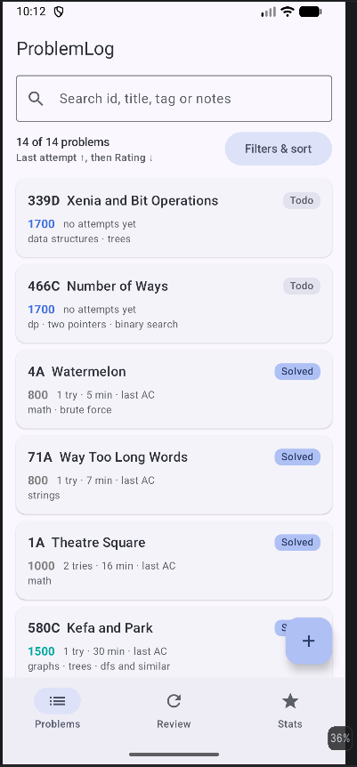
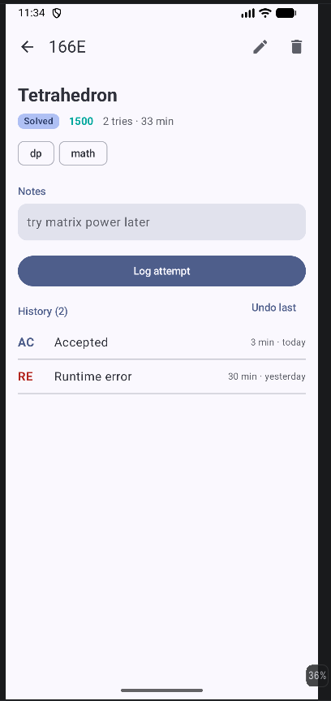
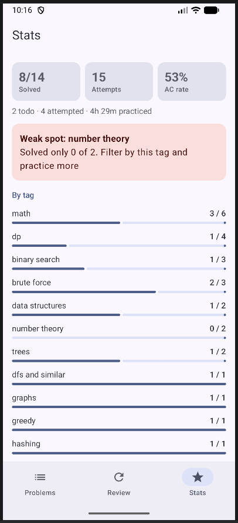

# ProblemLog (Android)

ProblemLog is a small Android app for tracking my Codeforces practice. When I train I solve some problems and fail others, and after a week I don't remember which ones were hard and why. So here I save every problem I tried, log each attempt with verdict and minutes, and then the app tells me what to redo and where my weak topics are.

It is the mobile version of my ProblemLog web project (Go + PostgreSQL), same idea but built with Kotlin and Jetpack Compose. Since HW3 all data is saved in a local **Room** database, so problems and attempts stay after closing the app.

## Features

**1. Problems: list, detail, add, edit, delete**
- list of problems in a `LazyColumn` with stable keys (problem id)
- tap a problem to open its detail screen
- add and edit form with validation: id like `4A` or `1850B`, no duplicate ids, title not empty, rating 800-3500 in steps of 100, at least one tag. known tags are suggested as chips so tag names stay consistent
- delete with a confirmation dialog (its attempts are deleted too)
- empty database shows "No problems yet" with a button to load 13 real Codeforces problems as sample data

**2. Attempt history with status workflow and undo** (the main feature)
- on the detail screen press "Log attempt", choose verdict and minutes
- status goes through todo → attempted → solved:
  - AC marks the problem as **solved**
  - a failed attempt on a **todo** problem moves it to **attempted**
- every attempt is saved in the database, full history is shown on the detail screen (newest first)
- snackbar tells what changed and has an **Undo** button. undo deletes the last attempt and the status goes back by itself
- status is not stored separately, it is always calculated from the saved attempts, so it can never disagree with the history

**3. Review list (simple spaced repetition)**
- problems where the last attempt failed
- problems solved more than 14 days ago
- failed ones come first, then oldest solved

**4. Stats**
- solved count, total attempts, AC rate, time practiced
- solved/total per tag and per rating range (800-999, 1000-1199, ...) with progress bars
- "weak spot" card: tag with the lowest solved ratio (only tags with 2+ problems)

**5. Search, filters and sorting** on the problem list
- search in id, title, tags and notes
- filters: status, tags (Any / All), rating range, last verdict, "needs review only"
- sort by two keys, each asc or desc

All screens read from the same database, so logging an attempt on the detail screen updates the list, review and stats right away, without any refresh.

## Screens and navigation

Navigation Compose with 5 destinations:

| Route | Screen |
|---|---|
| `problems` | problem list + search + filter sheet (bottom tab) |
| `review` | review list (bottom tab) |
| `stats` | stats (bottom tab) |
| `problem/{id}` | problem detail, attempt history, log attempt dialog |
| `edit?id={id}` | add problem (no id) or edit problem (with id) |

## Architecture (MVVM)

```
data/
  local/     Entities.kt (ProblemEntity, AttemptEntity, ProblemWithAttempts + mappers)
             ProblemDao.kt (queries), AppDatabase.kt (Room database)
  Models.kt (Problem, Attempt, Status, Verdict), SampleData.kt
  ProblemRepository.kt (only class that uses the DAO)
logic/       ProblemRules.kt (status rule, review rule, validation)
             FilterState.kt (filter + sort), Stats.kt
ui/          ProblemsViewModel.kt
             navigation/AppNavHost.kt
             screens/  list, detail, edit, review, stats
             components/  ProblemCard, FilterSheet, SearchField, EmptyState ...
```

Data goes one way: **Room → Repository → ViewModel → screens**. User actions go back the other way: screen → ViewModel method → Repository → DAO.

- **UI** only draws state and sends events. Every screen has a `...Route` composable that collects state from the ViewModel and a stateless `...Screen` composable that gets plain values + lambdas (state hoisting). Composables never change data themselves, they call ViewModel methods
- **ViewModel** exposes `StateFlow`s (`allProblems`, `visibleProblems`, `reviewItems`, `stats`, `message`...) and has one method per user action (`saveProblem`, `deleteProblem`, `logAttempt`, `undoLastAttempt`, `loadSamples`)
- **Repository** turns database rows into app models and back, so the ViewModel and screens never see Room classes
- **logic** is plain Kotlin functions without Android code, the same rules as before Room

### Room database

- two tables: `problems` and `attempts`. `attempts.problemId` is a foreign key with `CASCADE`, so deleting a problem deletes its attempts
- `ProblemWithAttempts` uses `@Relation` to load a problem together with its attempts
- `ProblemDao.observeAll()` returns `Flow<List<ProblemWithAttempts>>`. Room sends a new list every time one of the tables changes, so the UI updates by itself
- CRUD:
  - **create**: `upsertProblem`, `insertAttempt`
  - **read**: `observeAll`
  - **update**: `upsertProblem` (the edit form)
  - **delete**: `deleteProblem`, `deleteLastAttempt` (undo)
- `@Upsert` updates the row in place, so editing a problem keeps its attempts
- loading samples runs in one `@Transaction` and only when the table is empty

### State and configuration changes

- screens collect state with `collectAsStateWithLifecycle()`
- `isLoading` is true until Room sends the first list, so the list shows a spinner instead of a wrong empty state
- feedback messages (added, saved, deleted, loaded) come from the ViewModel `message` flow and are shown in a snackbar on any screen
- rotating keeps everything: data is in Room, filters are in the ViewModel, the search query is in `SavedStateHandle`, and UI state (open dialogs, form fields) uses `rememberSaveable`

## Tech

- Kotlin, Jetpack Compose, Material 3
- Navigation Compose
- ViewModel (`AndroidViewModel`) + StateFlow + SavedStateHandle
- Room (Entity, DAO, Relation, Flow, Upsert, Transaction) with KSP
- Kotlin coroutines and Flow (`combine`, `map`, `stateIn`)

## How to run

1. Clone the repo
   ```
   git clone <repo-url>
   ```
2. Open the folder in Android Studio (File → Open), wait for Gradle sync to finish
3. Select an emulator or a real phone (Android 7.0 / API 24 or newer)
4. Press **Run ▶** (Shift + F10)
5. On first launch the database is empty: tap **Load sample problems** or add your own with **+**

## Screenshots

| Problem list | Detail with history and undo | Stats |
|---|---|---|
|  |  |  |

## Plans

- import problem title, rating and tags from the Codeforces API by id
- daily reminder with WorkManager when the review list is not empty
